# 🇲🇦 Portail Web du Haut-Commissariat au Plan (HCP)

Application web dynamique développée en **PHP / MySQL** qui reproduit et modernise le portail du Haut-Commissariat au Plan du Maroc. Elle permet la consultation publique des publications, enquêtes et statistiques, ainsi qu'une **interface d'administration** complète pour gérer tout le contenu du site.

---

## 📌 Présentation

Le projet se compose de deux parties :

- **Site public** : accessible à tous les visiteurs, pour consulter et télécharger les données du HCP.
- **Espace d'administration** : sécurisé par authentification, pour gérer les utilisateurs, les enquêtes, les statistiques, les publications et le contenu du site.

Un **assistant IA (chatbot)** est également intégré pour répondre aux questions des visiteurs sur le HCP.

---

## ✨ Fonctionnalités

### 🌐 Partie publique

| Page | Description |
|------|-------------|
| **Accueil** | Page d'accueil avec présentation du HCP et accès rapide aux publications et statistiques |
| **À propos** | Mission, valeurs et chiffres clés (PIB réel, population, dépenses publiques, inflation) |
| **Institutions** | Présentation du HCP, chiffres clés et domaines d'intervention (démographie, économie, environnement, éducation, social, territoires) |
| **Découvrir** | Carte du Maroc et liste des 12 directions régionales avec accès à leur fiche détaillée |
| **Fiche régionale** | Présentation de la direction, missions, chiffres clés (habitants, croissance, superficie, chômage), localisation Google Maps et liens utiles |
| **Publications** | Liste filtrable (recherche, date, catégorie) avec page de détail et téléchargement |
| **Enquêtes** | Liste des enquêtes avec recherche par mot-clé et par date, téléchargement |
| **Statistiques** | Liste des statistiques filtrable par catégorie, date et mot-clé |
| **Contact** | Formulaire de contact, coordonnées, horaires d'ouverture, carte et réseaux sociaux |
| **Assistant HCP** | Chatbot IA pour obtenir des informations sur le site et l'institution |

### 🔐 Espace d'administration

- **Authentification sécurisée** (connexion, « se souvenir de moi », mot de passe oublié)
- **Tableau de bord** : indicateurs clés (enquêtes, statistiques, publications, utilisateurs, brouillons, téléchargements) et graphiques interactifs (Chart.js)
- **Gestion des utilisateurs** : ajout, modification, suppression, blocage, rôles, export
- **Gestion des enquêtes** : CRUD complet, statuts (en cours, terminée, brouillon), filtres, graphiques de suivi
- **Gestion des statistiques** : par catégorie (Économie, Marché du travail, Développement durable, etc.), données économiques, réseau statistique et données démographiques
- **Gestion des publications** : catégories (Rapports et études, Notes et analyses, Bulletins et revues, Autres documents), compteur de téléchargements
- **Gestion du contenu du site** : directions régionales, description du site, liens des réseaux sociaux
- **Paramètres** : nom du site, email, téléphone, logo et favicon
- **Export** des données

---

## 🛠️ Technologies utilisées

- **Front-end** : HTML5, CSS3, JavaScript
- **Back-end** : PHP
- **Base de données** : MySQL
- **Graphiques** : Chart.js
- **Cartographie** : Google Maps (intégration)
- **Serveur local** : XAMPP
- **IA** : Chatbot intégré (API)

---

## 📁 Structure du projet


---

## 🚀 Installation

1. **Cloner le dépôt**
```bash
   git clone https://github.com/votre-utilisateur/hcp-portail.git
```
2. Placer le dossier dans `htdocs` de **XAMPP** (`C:/xampp/htdocs/Projets_web/Hpc`).
3. Démarrer **Apache** et **MySQL** depuis XAMPP.
4. Créer une base de données dans **phpMyAdmin** et importer le fichier `.sql` fourni.
5. Configurer la connexion à la base dans le fichier de configuration.
6. Accéder au site :
   - Site public : `http://localhost/Projets_web/Hpc/`
   - Administration : `http://localhost/Projets_web/Hpc/pages/login.php`

---


---
## 🖼️ Aperçu du projet

### 🌐 Partie publique

#### 🏠 Page d'accueil
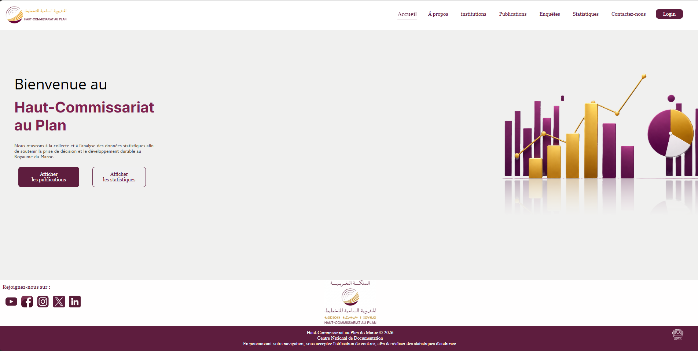

Page d'accueil du portail avec un message de bienvenue et une illustration de graphiques statistiques. Deux boutons d'accès rapide mènent aux **publications** et aux **statistiques**. Le menu de navigation donne accès à toutes les sections, et le bouton **Login** à l'espace d'administration.

---

#### ℹ️ À propos
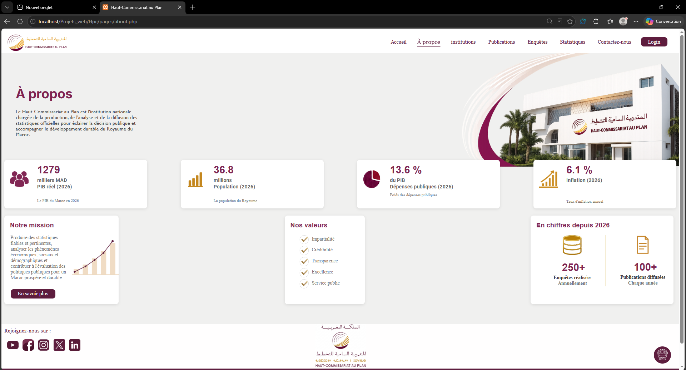

Présente le HCP, sa **mission** et ses **valeurs** (impartialité, crédibilité, transparence, excellence, service public). Elle affiche aussi les indicateurs clés : PIB réel, population, dépenses publiques et inflation, ainsi que les chiffres depuis 2026 (enquêtes réalisées et publications diffusées). Ces données sont modifiables depuis l'espace admin.

---

#### 🏛️ Institutions
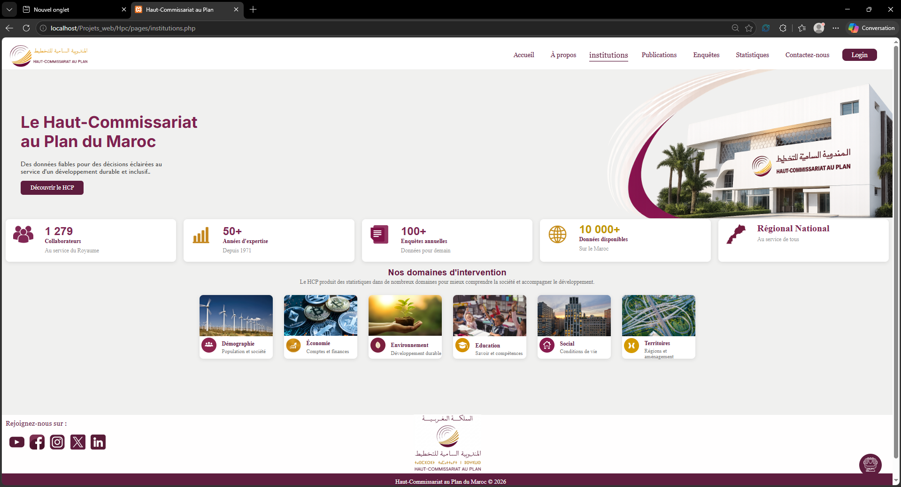

Présente le Haut-Commissariat au Plan : collaborateurs, années d'expertise, enquêtes annuelles et données disponibles. La section **« Nos domaines d'intervention »** couvre la démographie, l'économie, l'environnement, l'éducation, le social et les territoires. Le bouton **« Découvrir le HCP »** mène à la liste des directions régionales.

---

#### 🗺️ Découvrir : directions régionales
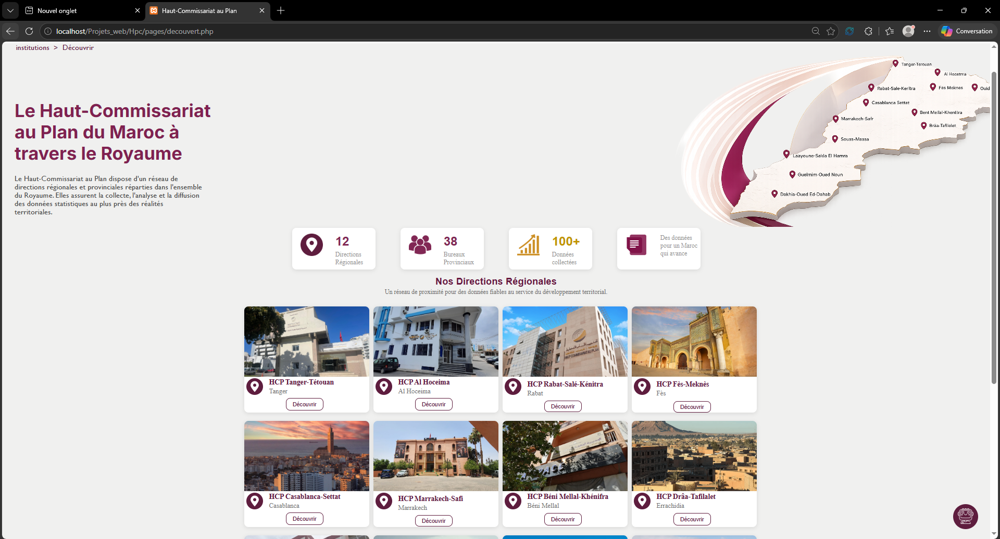

Carte interactive du Maroc avec les **12 directions régionales** et leurs bureaux provinciaux. Chaque direction (Tanger-Tétouan, Al Hoceima, Rabat-Salé-Kénitra, Fès-Meknès, Casablanca-Settat, etc.) est présentée sous forme de carte avec un bouton **« Découvrir »** vers sa fiche détaillée.

---

#### 📍 Fiche détaillée d'une direction régionale
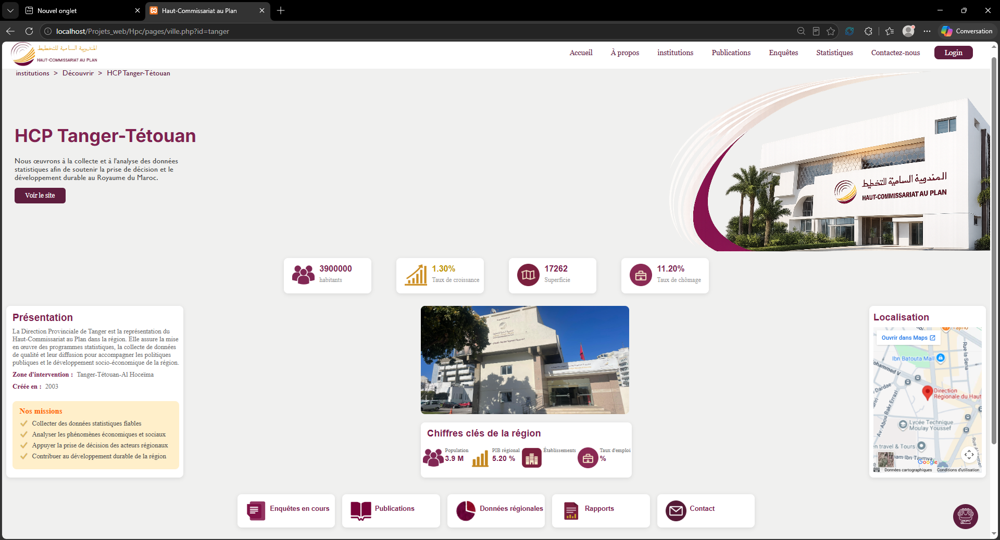

Page dynamique générée à partir de la base de données (exemple : **HCP Tanger-Tétouan**). Elle contient :
- les chiffres clés (habitants, taux de croissance, superficie, taux de chômage) ;
- la présentation, la zone d'intervention et les missions ;
- la localisation sur **Google Maps** ;
- des raccourcis vers les enquêtes, publications, données régionales, rapports et contact.

---

#### 📚 Publications
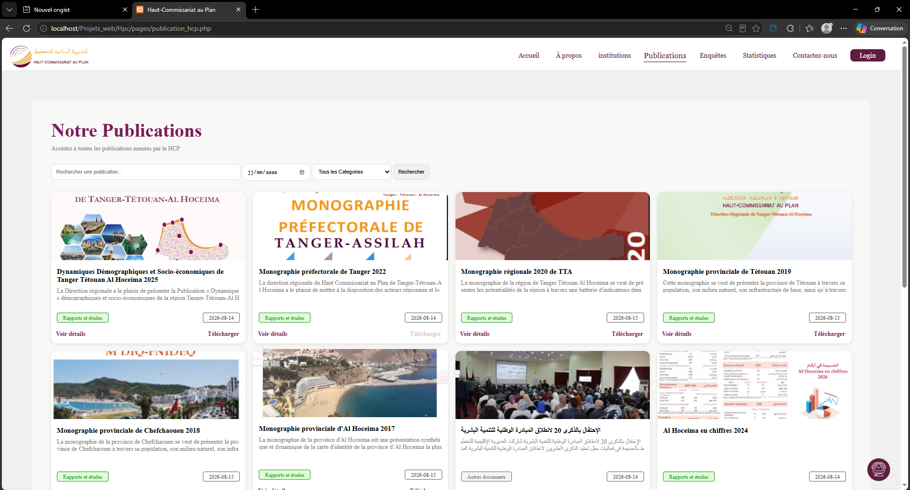

Liste des publications officielles sous forme de cartes (image, titre, extrait, catégorie, date). L'utilisateur peut **rechercher par mot-clé**, **filtrer par date et par catégorie**, consulter le détail ou **télécharger** le document.

---

#### 📄 Détail d'une publication
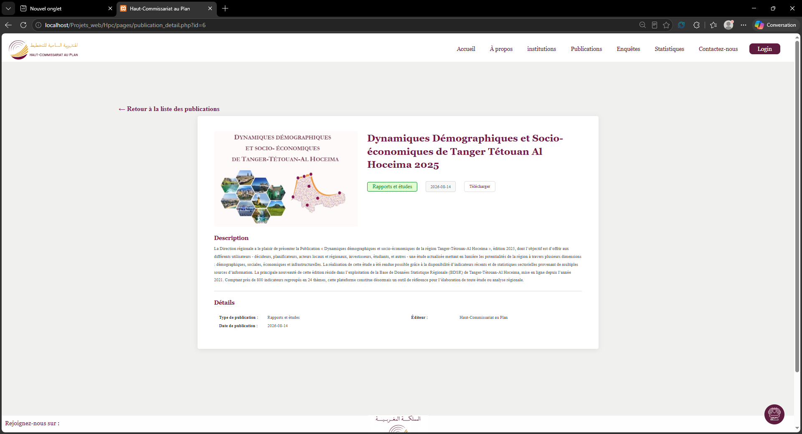

Page complète d'une publication : couverture, titre, catégorie, date, bouton de téléchargement, **description** détaillée et informations (type, date, éditeur). Un lien permet de revenir à la liste.

---

#### 📋 Enquêtes
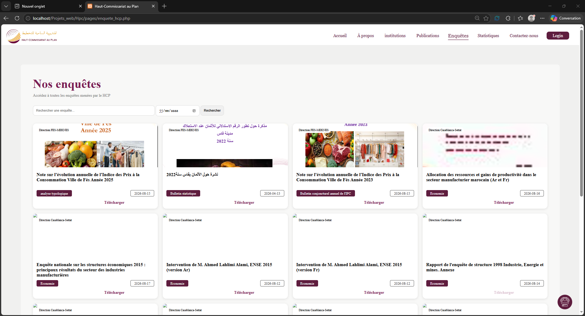

Catalogue des enquêtes menées par le HCP, avec **recherche par mot-clé et par date**. Chaque carte affiche le visuel, le titre, la catégorie, la date, la direction concernée et un lien de **téléchargement**.

---

#### 📊 Statistiques
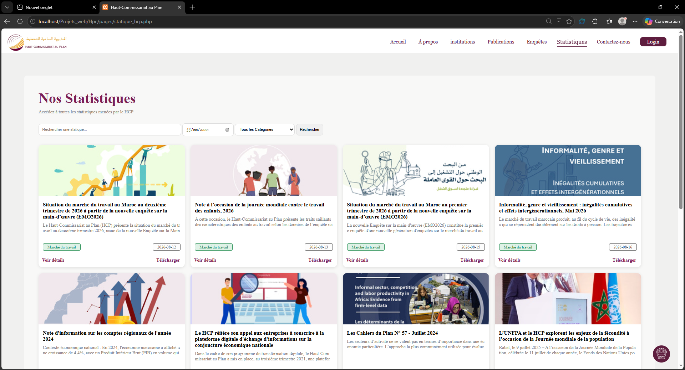

Liste des statistiques et notes d'information (marché du travail, comptes régionaux, démographie, etc.), avec **recherche, filtre par catégorie et par date**, consultation du détail et téléchargement.

---

#### ✉️ Contactez-nous
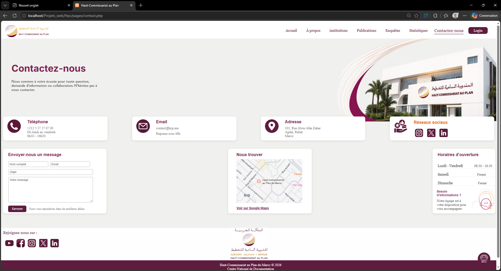

Coordonnées du HCP (téléphone, email, adresse), **formulaire de contact** (nom, email, objet, message), carte **« Nous trouver »** avec lien Google Maps, horaires d'ouverture et liens vers les réseaux sociaux.

---

#### 🤖 Assistant HCP (chatbot IA)
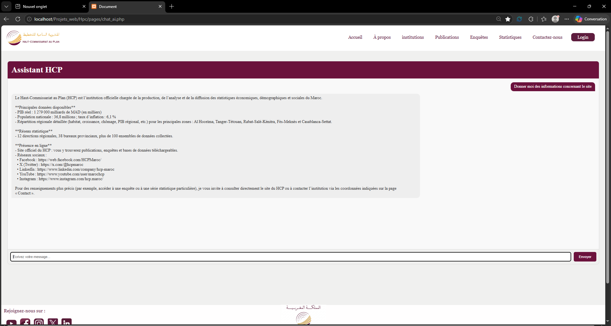

Assistant conversationnel intégré, accessible depuis toutes les pages via l'icône flottante en bas à droite. Il répond aux questions sur le HCP : chiffres clés, réseau statistique, présence en ligne et réseaux sociaux. Il propose aussi un bouton de question prédéfinie et un champ de saisie libre.

---

### 🔐 Espace d'administration

#### 🔑 Connexion administrateur
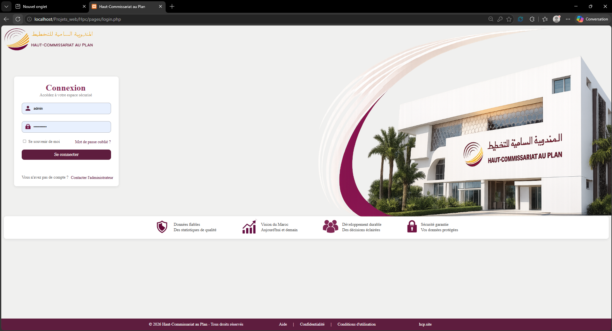

Page de connexion sécurisée avec identifiant et mot de passe, option **« Se souvenir de moi »**, lien **« Mot de passe oublié »** et contact de l'administrateur. Les atouts du portail (données fiables, vision du Maroc, développement durable, sécurité) sont rappelés en bas de page.

---

#### 📈 Tableau de bord
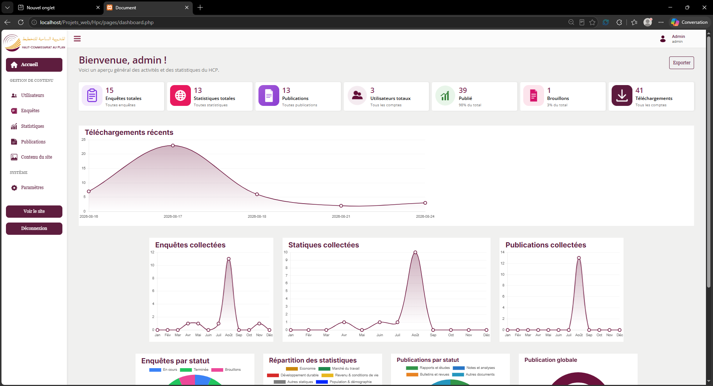

Vue d'ensemble de l'activité du HCP :
- **cartes de synthèse** : enquêtes, statistiques, publications, utilisateurs, brouillons, téléchargements ;
- **graphiques Chart.js** : téléchargements récents, enquêtes, statistiques et publications collectées par mois ;
- **répartitions par statut et par catégorie**.

Le menu latéral donne accès à toutes les sections, avec les boutons **« Voir le site »** et **« Déconnexion »**.

---

#### 👥 Gestion des utilisateurs
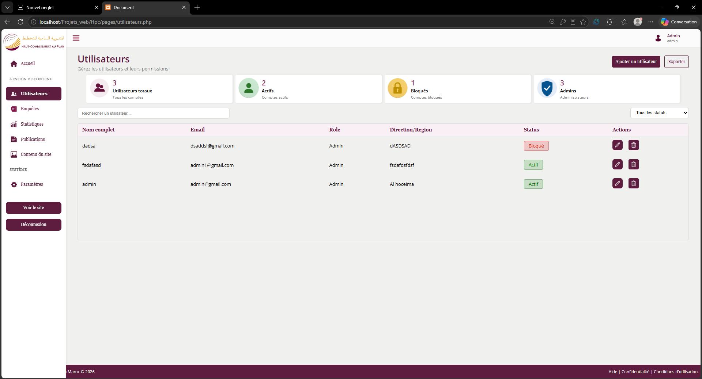

Gestion des comptes : indicateurs (total, actifs, bloqués, admins), **recherche**, **filtre par statut**, tableau avec nom, email, rôle, direction/région et statut (Actif / Bloqué). Actions disponibles : **ajouter, modifier, supprimer** un utilisateur et **exporter** la liste.

---

#### 📋 Gestion des enquêtes
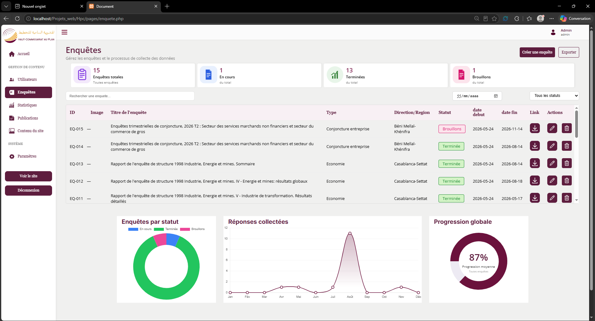

Gestion complète des enquêtes (création, modification, suppression, export) avec recherche, filtre par date et par statut. Le tableau affiche l'ID, le titre, le type, la direction, le statut (**Brouillon / En cours / Terminée**), les dates de début et de fin et le lien de téléchargement. Trois graphiques montrent la répartition par statut, les réponses collectées et la progression globale.

---

#### 📊 Gestion des statistiques
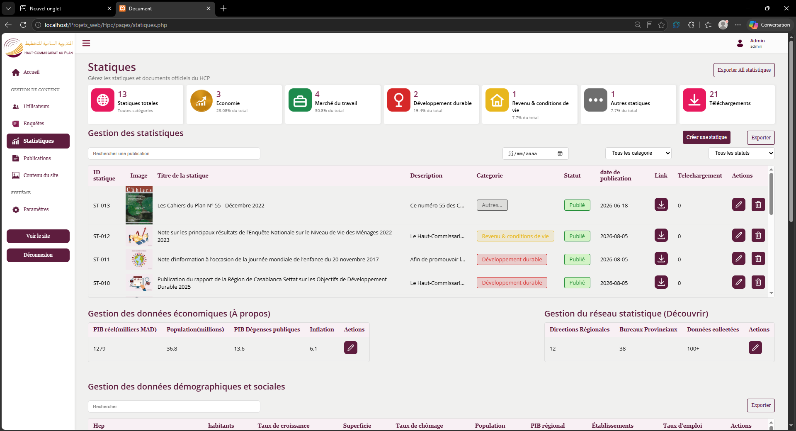

Gestion des statistiques par catégorie (Économie, Marché du travail, Développement durable, Revenu & conditions de vie, Autres) avec compteurs de téléchargements. Elle permet aussi de modifier :
- les **données économiques** de la page « À propos » (PIB, population, dépenses publiques, inflation) ;
- les **données du réseau statistique** (directions, bureaux, données collectées) ;
- les **données démographiques et sociales** de chaque région.

---

#### 📚 Gestion des publications
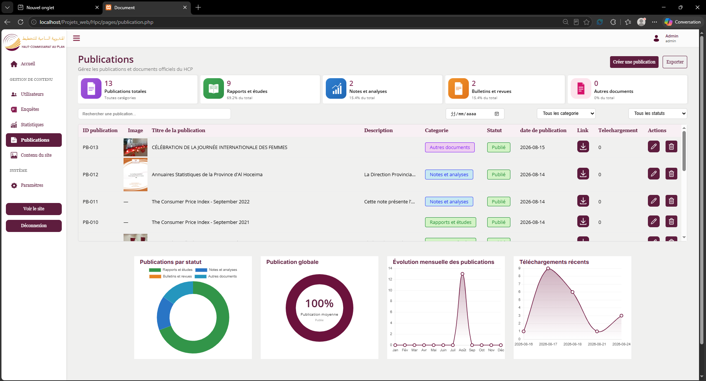

Gestion des publications par catégorie (Rapports et études, Notes et analyses, Bulletins et revues, Autres documents) : création, modification, suppression, export, recherche et filtres (date, catégorie, statut). Des graphiques montrent la répartition par statut, la publication globale, l'évolution mensuelle et les téléchargements récents.

---

#### 🖼️ Gestion du contenu du site
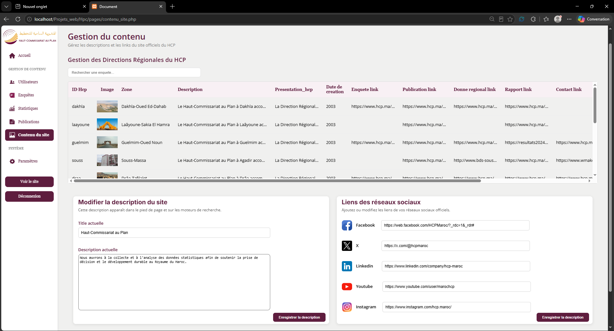

Gestion des **directions régionales** (image, zone, description, présentation, date de création, liens vers les enquêtes, publications, données régionales, rapports et contact). Cette page permet aussi de modifier la **description du site** (pied de page et SEO) et les **liens des réseaux sociaux** (Facebook, X, LinkedIn, YouTube, Instagram).

---

#### ⚙️ Paramètres du site
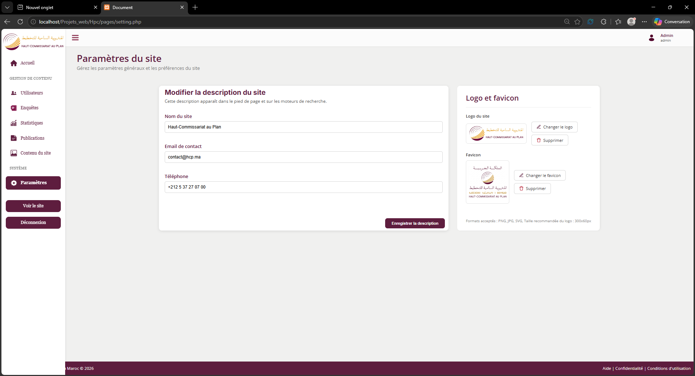

Configuration générale du site : **nom du site, email et téléphone de contact**, ainsi que gestion du **logo** et du **favicon** (changement ou suppression). Formats acceptés : PNG, JPG, SVG.


## 👤 Auteur

ILYASS BENHADI

---


## 📄 Licence

Projet réalisé à but pédagogique. Les logos et contenus appartiennent au Haut-Commissariat au Plan du Maroc.
